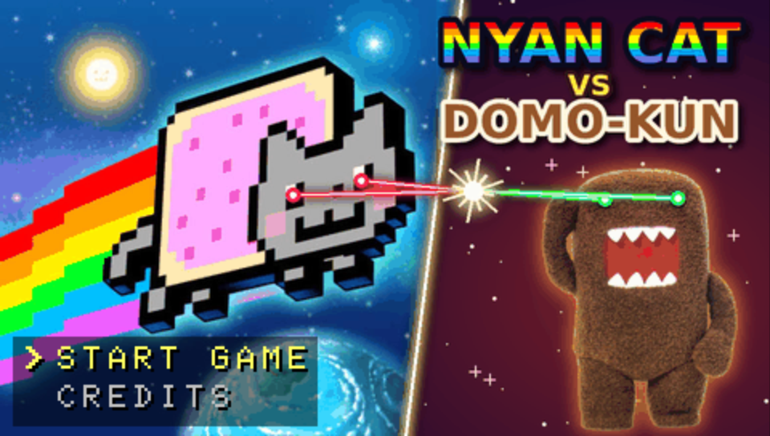
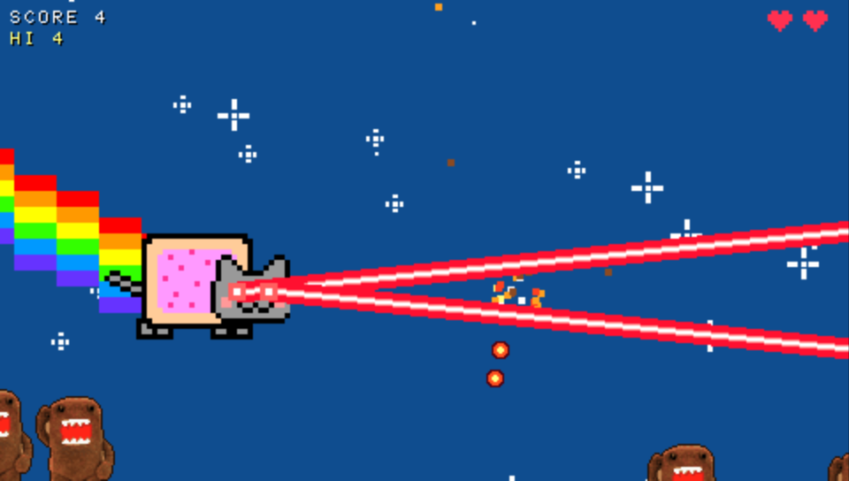
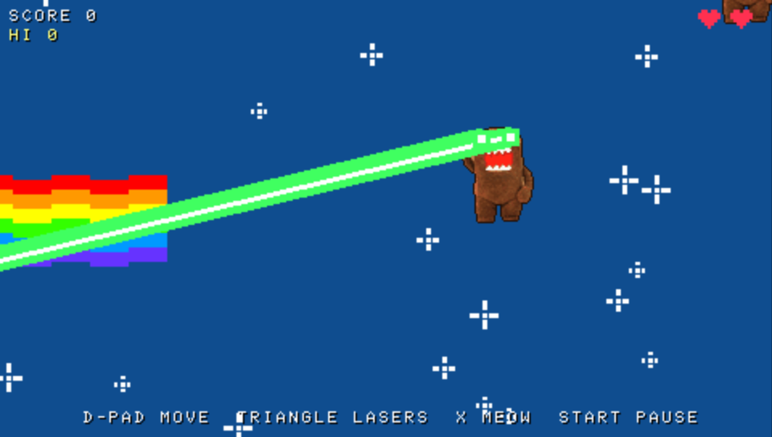
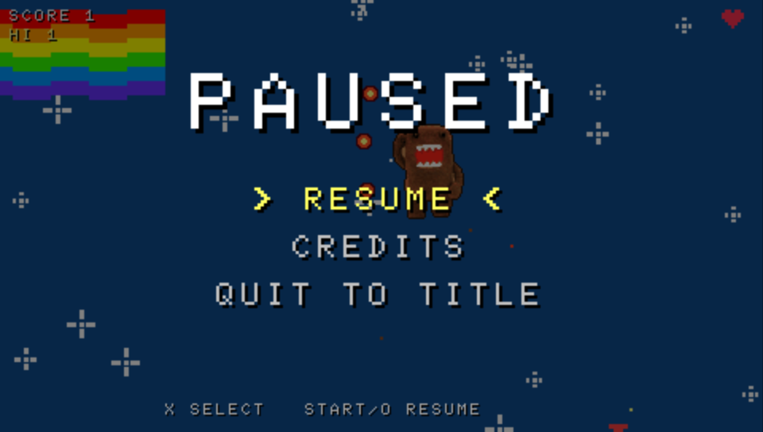
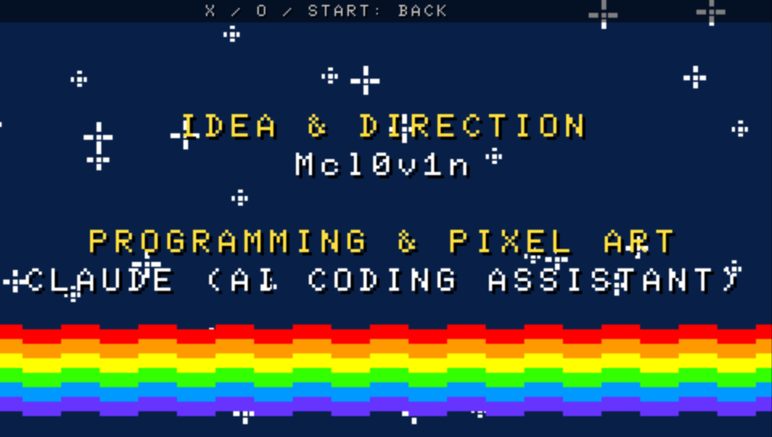

# Nyan Cat vs Domo-kun

A homebrew shoot-'em-up vidya for the **Sony PSP**. Fly Nyan Cat through space, dodge the Domo-kun horde's spit balls and eye lasers, and blast them with your own laser eyes. 🌈🐱⚡

> ⚠️ **This vidya is 100% vibecoded.** See the [vibecoded disclaimer](#-vibecoded-disclaimer) before you read the code.



| Gameplay | Domo eye lasers |
|---|---|
|  |  |
| **Pause menu** | **Credits** |
|  |  |

## Features

- Pixel-art Nyan Cat with a rainbow trail that follows your flight path
- Domo-kun enemies converted from a photo of the real plush
- Six Domo attacks, unlocked as your score climbs: rapid burst, fan spread, dash, homing balls, ring burst and eye lasers
- Laser eyes that destroy Domos and shoot down their projectiles
- A world two screens tall with a scrolling camera, 3 lives, score and hi-score
- Title screen, pause menu and scrolling credits
- All sound effects are synthesized in code: meow, lasers, explosions and spit
- Optional on-screen performance meter (frame time + FPS)

## Controls

| PSP | Action | PPSSPP default key |
|---|---|---|
| D-pad | Move | Arrow keys |
| △ Triangle (hold) | Laser eyes | `S` |
| ✕ Cross | Meow (and menu select) | `Z` |
| START | Pause / start / retry | `Space` |
| ○ Circle | Back / title screen (from game over) | `X` |
| SELECT | Toggle performance meter | `Enter` |

## Install

### On a real PSP

> **Requires custom firmware** (e.g. [ARK-4](https://github.com/PSP-Archive/ARK-4), PRO or LME). Unsigned homebrew won't run on stock firmware.

1. Download `NyanCatVsDomo.zip` from the [latest release](../../releases/latest).
2. Connect the PSP to your computer with **Settings → USB Connection**.
3. Extract the zip to the root of the memory stick, so you end up with:
   ```
   PSP/GAME/NyanCatVsDomo/EBOOT.PBP
   ```
4. Exit USB mode and launch it from **Game → Memory Stick**.

### In the PPSSPP emulator

Download `EBOOT.PBP` from the [latest release](../../releases/latest) and open it with [PPSSPP](https://www.ppsspp.org/) (**Load…**, or drag the file onto the window).

## Building from source

You need the [PSPDEV toolchain](https://pspdev.github.io/). Prebuilt releases are available for Linux, macOS and Windows (WSL).

```bash
# install the toolchain (example: Linux x86_64)
curl -fsSL -o pspdev.tar.gz https://github.com/pspdev/pspdev/releases/latest/download/pspdev-ubuntu-latest-x86_64.tar.gz
tar -xzf pspdev.tar.gz -C ~
export PSPDEV=~/pspdev PATH=$PATH:$PSPDEV/bin

# build
git clone https://github.com/McL0v1n-therealone/nyan-cat-vs-domo-kun.git
cd nyan-cat-vs-domo-kun
mkdir build && cd build
psp-cmake .. && make          # -> build/EBOOT.PBP
```

**Copy to a connected PSP (Linux):** `./deploy-psp.sh` waits for a PSP in USB mode, copies the build to `PSP/GAME/NyanCatVsDomo/` and safely unmounts it.

**Test later difficulty levels:** to start at a higher score, configure a separate build directory with `psp-cmake -DCMAKE_C_FLAGS="-DSTART_SCORE=15" ..`.

### Regenerating the art

The generated headers are committed, so building only needs the toolchain. To change the art you also need Python 3 and Pillow:

| Script | Makes |
|---|---|
| `tools/domo_from_image.py "Domo_kun_(NHK_mascot).webp" domo_sprite.h 58` | In-game Domo sprite: background removed, scaled down, color-reduced, outlined, with mouth and eye positions detected |
| `tools/make_logo.py` | `images/logo.png`, the PSP menu icon and background (`assets/ICON0.PNG`, `assets/PIC1.PNG`), and the title screen (`title_img.h`) |

## How it works

- **Graphics:** software-rendered straight into the 32-bit framebuffers in VRAM (double-buffered, drawn through the CPU cache, written back before each flip). No GPU (GU) is used.
- **Audio:** a dedicated thread mixes a pre-synthesized meow with real-time synthesized laser hums, explosions and spit sounds.
- **Sprites:** Nyan Cat is drawn from small character-map pixel art. The Domo sprite and title screen are palettized data generated by the Python tools.

## Credits

- **Idea & direction:** Mcl0v1n ([McL0v1n-therealone](https://github.com/McL0v1n-therealone))
- **Programming & pixel art:** Claude (AI coding assistant)
- **Nyan Cat** character: Chris Torres (2011)
- **Domo-kun** character: NHK / Tsuneo Goda (1998)
- **Domo-kun PNG** used in the title art: by nickfamzi
- **Toolchain:** [PSPDEV / PSPSDK](https://github.com/pspdev) · tested in [PPSSPP](https://www.ppsspp.org/)

## 🤖 Vibecoded disclaimer

This project was **vibecoded**. Mcl0v1n described what they wanted ("make the Domo-kuns shoot lazers too", "a 4 year old can beat this") and an AI coding assistant (Claude) wrote, built and tested everything. That includes the C code, the pixel art, the sprite and logo scripts, and the build and deploy setup. In practice that means:

- **No human reviewed the code line by line.** It works, but it is one big `main.c` that grew feature by feature. Expect magic numbers, copy-pasted logic and not much structure.
- **Testing was mostly in the PPSSPP emulator**, by scripted key presses and screenshots, plus a few runs on a real PSP. Real hardware showed rendering glitches that the emulator didn't, and the fixes have had little real-hardware testing so far.
- **Difficulty tuning is based on vibes**, not playtesting. Domo attack timings and speeds were changed whenever someone said it was too easy.
- **Use it as a fun example, not a reference** for how to write PSP homebrew properly. If you want to learn, read the [PSPDEV docs](https://pspdev.github.io/) too.

Bug reports and PRs are welcome, vibecoded or not.

## Disclaimer

This is a non-commercial fan project. It is not affiliated with or endorsed by Chris Torres, NHK, or Sony. Nyan Cat and Domo-kun belong to their respective owners.
